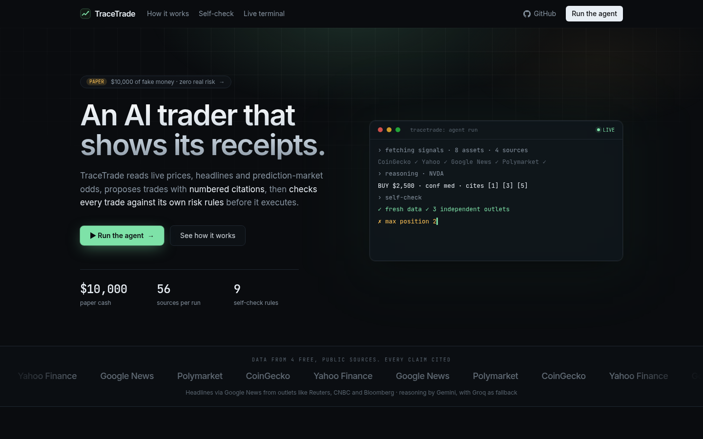
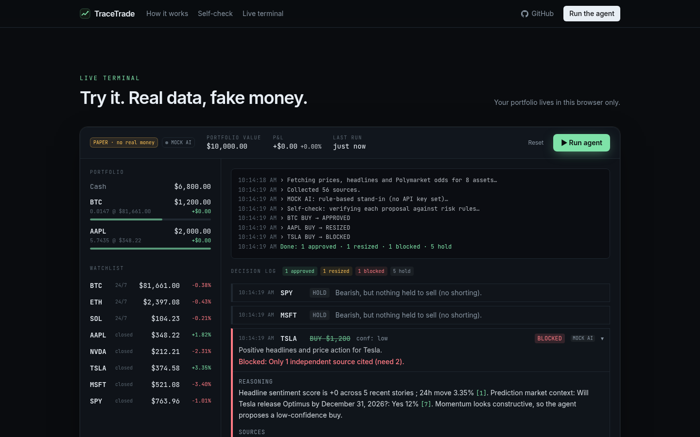
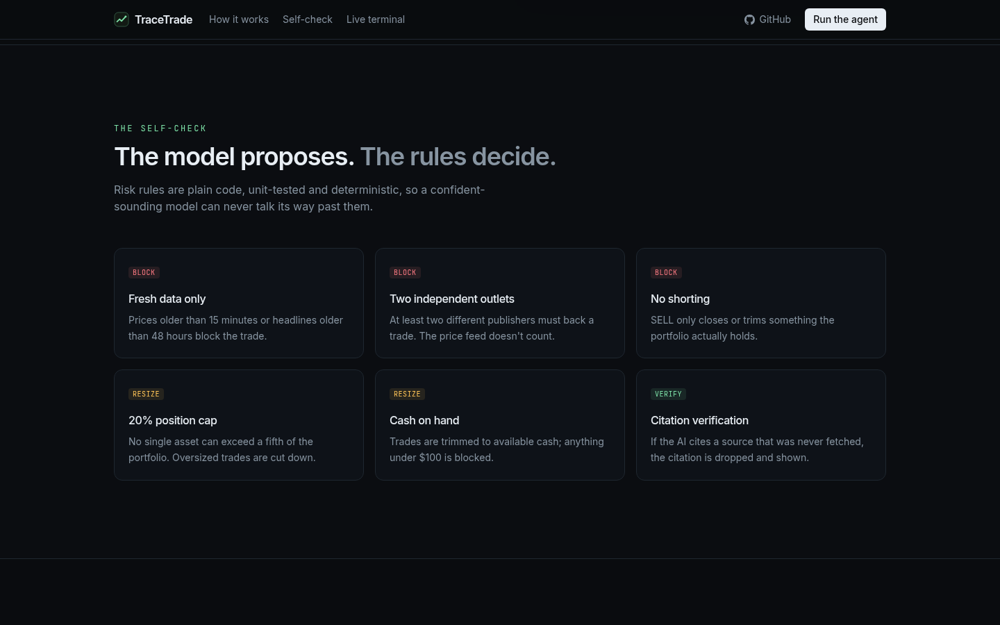
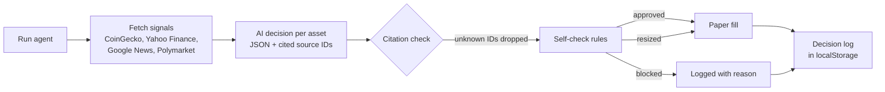

# TraceTrade

**An AI paper trader that shows its receipts and checks every trade against its own risk rules before it executes.**

[](LICENSE)
[](https://nextjs.org)
[](https://www.typescriptlang.org)

**Live demo: [tracetrade.vercel.app](https://tracetrade.vercel.app)**

Built for the Devpost hackathon **Build With AI: Basics**.



## What it does

TraceTrade gives an AI agent **$10,000 of paper money** and a watchlist of 8 assets: BTC, ETH, SOL, AAPL, NVDA, TSLA, MSFT and SPY.

Each time you press **Run agent**, it:

1. Reads live prices, recent headlines and Polymarket odds (about 56 sources per run).
2. Asks an AI model for a BUY, SELL or HOLD decision for each asset, with **numbered citations** to the sources it used.
3. Runs every proposed trade through a deterministic **self-check**. Plain code, not the model, decides whether the trade is approved, resized or blocked.
4. Fills approved trades on paper and keeps a receipt with the reasoning, sources and check results.

Most "AI trader" demos show you a decision. TraceTrade shows you **why**, and it shows the trades its own rules stopped.



## The self-check rules

The model proposes; the rules decide. The rules live in [`lib/selfCheck.ts`](lib/selfCheck.ts), use the thresholds in [`lib/config.ts`](lib/config.ts), and are unit tested.

| Rule | Effect | What it checks |
| --- | --- | --- |
| Data freshness | Block | The price must be under 15 minutes old (last close is accepted when the market is shut) and the headlines under 48 hours old. A missing price blocks the trade. |
| Independent sources | Block | At least 2 different news outlets must be cited. The price feed does not count. |
| Holding exists | Block | A SELL can only close or trim a position you hold. No shorting. |
| Max position | Resize | No single asset can be more than 20% of the portfolio. |
| Cash available | Resize | A BUY is trimmed to the cash you have. |
| SELL within holding | Resize | A SELL is capped at the quantity held. |
| Minimum trade | Block | Anything under $100 after resizing is blocked. |
| Market hours | Flag | Stock trades outside US hours (Mon-Fri 9:30-16:00 ET) fill at the last close and are flagged. |



## How a run works



`POST /api/run` streams progress as NDJSON, so the trace in the UI updates live while the run happens. The portfolio and decision log stay in your browser, and there is no database.

## Citation verification

Every fetched item gets an ID such as `NVDA-PX`, `NVDA-N3` or `NVDA-P1`. The model must cite these IDs in its reasoning. After the call, TraceTrade compares the cited IDs with the sources it actually fetched:

- Real citations become numbered links (`[1]`, `[3]`) to the original article or market.
- Unknown citations are dropped and shown struck through as `[?]`, so a made-up source can't pass as evidence.
- The independent-sources rule counts only verified citations.

## Data sources

All free and public, with no API keys:

| Source | Used for |
| --- | --- |
| [CoinGecko](https://www.coingecko.com) | Crypto prices and 24h change |
| [Yahoo Finance](https://finance.yahoo.com) chart API | Stock and ETF prices, market state |
| [Google News RSS](https://news.google.com) | Recent headlines and their outlets (Reuters, CNBC, Bloomberg and others) |
| [Polymarket](https://polymarket.com) Gamma API | Prediction-market odds related to each asset |

Reasoning uses **Gemini** (free tier, through its OpenAI-compatible API). If it fails, the agent falls back to **Groq** (free tier). Every decision card shows which model made it.

## Tech stack

Next.js 16 (App Router), React 19, TypeScript, Tailwind CSS 4, the `openai` SDK pointed at OpenAI-compatible endpoints, zod for output validation, fast-xml-parser for RSS, and Vitest.

## Quick start

```bash
git clone https://github.com/Kayd-06/tracetrade.git
cd tracetrade
npm install
cp .env.example .env.local   # optional: add a free key
npm run dev                  # http://localhost:3000
```

Without any key, the app runs in **MOCK AI** mode: a clearly labelled, rule-based stand-in that still uses the real live signals, so the full flow works for a demo.

### Environment variables

| Variable | Required | Purpose |
| --- | --- | --- |
| `GEMINI_API_KEY` | Recommended | Free key from [Google AI Studio](https://aistudio.google.com/apikey). Primary provider. |
| `GROQ_API_KEY` | Optional | Free key from [Groq](https://console.groq.com/keys). Fallback when Gemini errors, rate-limits or times out. |
| `GEMINI_MODEL` | Optional | Pin one Gemini model instead of the default free-tier fallback chain. |
| `GROQ_MODEL` | Optional | Pin one Groq model (default chain: `openai/gpt-oss-120b`, then `openai/gpt-oss-20b`). |
| `MOCK_LLM` | Optional | Set to `1` to force mock mode even when keys are present. |
| `LLM_BASE_URL`, `LLM_MODEL` | Optional | Any OpenAI-compatible endpoint, tried first. Use `LLM_API_KEY` if it needs a key. |

Keep keys in `.env.local`. It is gitignored, so never commit them.

## Deploy to Vercel

1. Import the repo at [vercel.com/new](https://vercel.com/new). The free Hobby plan is enough.
2. Add `GEMINI_API_KEY` and, optionally, `GROQ_API_KEY` under **Environment Variables**.
3. Deploy. Model calls have short timeouts so a run fits inside Vercel's function limit.

## Testing

```bash
npm test        # Vitest: self-check rules and citation verification
npm run lint
npm run build
```

## Project structure

```
app/
  page.tsx            Landing page + live terminal
  api/run/            Streaming agent run (NDJSON)
  api/prices/         Watchlist quotes + current AI mode
components/
  Landing.tsx         Hero, source marquee, pipeline, rules, footer
  Dashboard.tsx       Live terminal: portfolio, watchlist, trace, decision log
  DecisionCard.tsx    One decision with reasoning, citations and checks
  Reveal.tsx          Scroll reveal + cursor-glow cards
hooks/
  usePortfolio.ts     Portfolio state in localStorage
  useMotion.ts        Reduced-motion, in-view and count-up hooks
lib/
  agent.ts            LLM provider chain, prompt, citation verification, mock mode
  runAgent.ts         Orchestrates one run and emits events
  selfCheck.ts        The deterministic risk rules (+ selfCheck.test.ts)
  portfolio.ts        Paper fills and valuation
  signals/            CoinGecko, Yahoo, Google News, Polymarket fetchers
devpost/              Planning docs
docs/screenshots/     README images
```

## Planning docs

The project was planned before it was built:

- [Scope](devpost/scope.md): the idea, the core demo moment and what was cut.
- [PRD](devpost/prd.md): screens, user journey, states and product decisions.
- [Spec](devpost/spec.md): architecture, verified data sources and trade-offs.

## Limitations

- Paper fills at the last fetched price, with no slippage, fees or order book.
- Market hours use fixed US hours and ignore holidays.
- Runs are manual. There is no scheduler.
- State lives in one browser's localStorage, so there are no accounts or cross-device sync.
- Free-tier AI and data APIs can rate-limit. The agent falls back across models and then holds, but a run may come back with fewer trades.
- Social-media sentiment is not included because there was no reliable free source.

## Disclaimer

TraceTrade is an educational simulation. It trades **paper money only**, connects to no brokerage or exchange, and nothing it outputs is financial advice.

## License

[MIT](LICENSE)
